<div align="center">

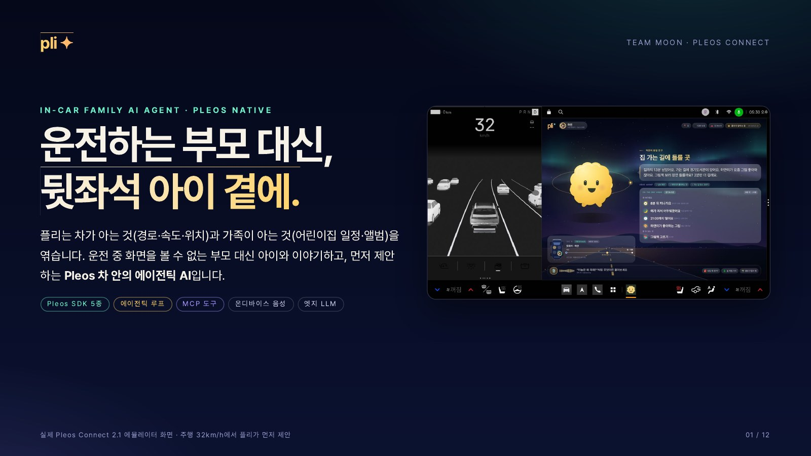

# 플리 Pli ✦

### 운전하는 부모 대신, 뒷좌석 아이 곁에.

**Pleos Connect 위에서 동작하는 차량용 가족 AI 에이전트**<br>
차가 아는 것(경로·속도·위치)과 가족이 아는 것(어린이집 일정·앨범)을 엮어,<br>
화면을 볼 수 없는 부모 대신 아이와 이야기하고 **먼저 제안**합니다.


[제품 영상](#-제품-영상) · [기획서 PDF](docs/pli-pleos-product-brief.pdf) · [사용 설명서](docs/manual/USER-GUIDE.md) · [심사 시연 가이드](docs/manual/DEMO-GUIDE.md) · [설치·실행](docs/manual/INSTALL.md) · [기술 문서](docs/manual/ARCHITECTURE.md)

**TEAM MOON**

</div>

---

## 한눈에 보기

| | |
|---|---|
| **무엇** | 뒷좌석 아이와 이야기하고, 차량 신호를 읽어 먼저 제안하는 Pleos 네이티브 앱 + 차량 엣지 AI + MCP 도구 서버 |
| **누구에게** | 미취학·초등 저학년 자녀와 등·하원, 학원 이동이 잦은 가족 |
| **어떻게** | 말 한마디와 차량 신호만으로 **계획 → 도구 실행 → 관찰 → 답**. 일정·준비물 같은 가족 사실은 도구 결과로만 말합니다 |
| **어디서** | 공식 **Pleos Connect 2.1 에뮬레이터**에서 실제 APK가 실제 음성을 듣고 답합니다. 영상의 기능 장면도 모두 실제 화면 녹화입니다 |

> **“하연아, 거기 가 볼까?”** — 플리가 만드는 건 답변이 아니라, 가족이 함께 고르는 다음 장면입니다.

---

## 왜 차 안인가

하원길 20분, 부모는 운전하고 아이는 뒷좌석에서 혼자입니다.

| 아이 | 부모 |
|---|---|
| “엄마, 심심해. 언제 도착해?” | “내일 뭐 챙겨야 하지?” — 일정·준비물은 휴대폰 앱 안에, 운전 중엔 못 엽니다 |
| “오늘 나 뭐 했는지 알아?” | 선생님이 올린 사진은 수십 장, 우리 아이 장면만 골라 보기 어렵습니다 |
| | “가는 길에 들를 데 없나?” — 날씨·시간·아이 취향을 운전하며 따지기는 무리입니다 |

**차는 이미 어디로 가는지, 얼마나 남았는지, 지금 어디인지 압니다. 가족 서비스는 아이의 일정과 사진을 압니다.**
플리는 둘을 엮어 차 안에서만 가능한 순간을 만듭니다.

---

## 하원길 12분, 플리가 하는 일

네 장면 모두 실제 APK가 실제 음성을 듣고 답한 **Pleos Connect 2.1 에뮬레이터 화면**입니다. 왼쪽은 Pleos 차량 화면(주행 32km/h), 오른쪽이 플리입니다.

<table>
<tr>
<td width="50%">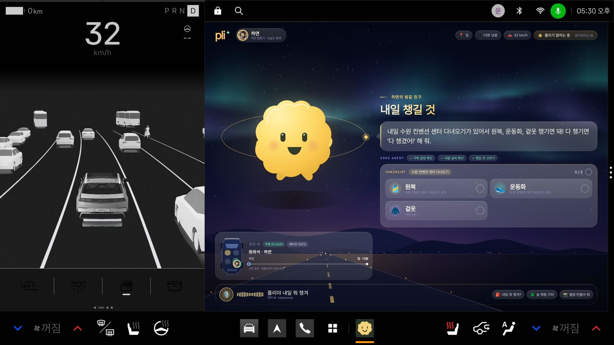</td>
<td width="50%">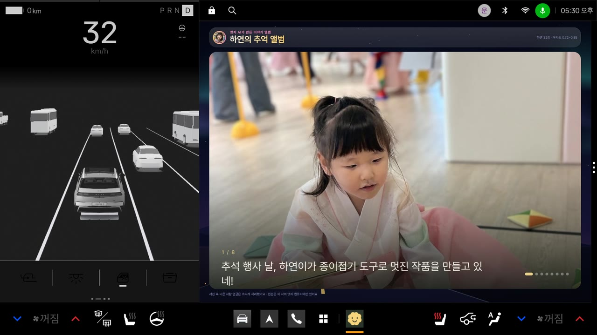</td>
</tr>
<tr>
<td><b>① 하연 “플리야, 내일 뭐 챙겨?”</b><br>어린이집 일정을 <b>MCP 도구</b>로 조회하고 날씨·목적지를 더해 준비물 카드로. “다 챙겼어!”로 하나씩 체크합니다.</td>
<td><b>② 엄마 “하연이 사진으로 앨범 만들어 줄래?”</b><br><b>얼굴 인식</b>으로 하연이가 나온 사진만 고르고 다른 아이 얼굴은 흐리게. 쪽마다 엣지 AI가 이야기를 들려줍니다.</td>
</tr>
<tr>
<td>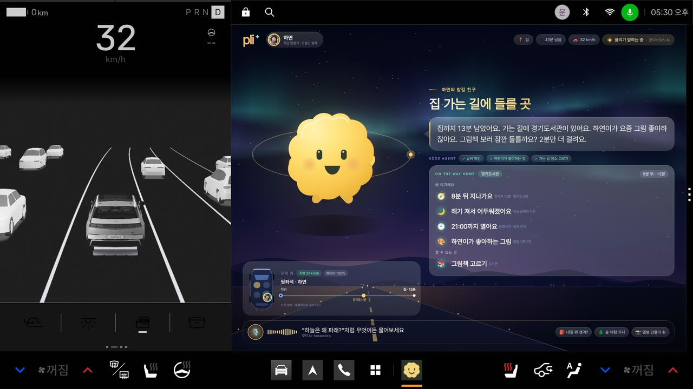</td>
<td>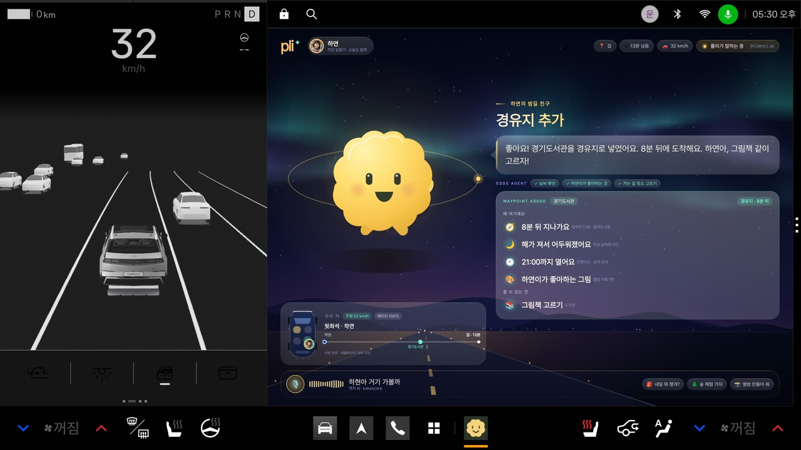</td>
</tr>
<tr>
<td><b>③ 플리가 먼저 “가는 길에 경기도서관이 있어요”</b><br>주행 중, 대화가 비어 있을 때 <b>경로·남은 시간·날씨·운영시간·아이 취향</b>(앨범의 그림 18회)을 따져 한 곳만 제안합니다.</td>
<td><b>④ 엄마 “하연아, 거기 가 볼까?”</b><br>부모의 한마디 승인 뒤에만 <b>NaviHelper.addWaypoint</b>로 경유지를 넣습니다. 거절하면 그대로 집으로.</td>
</tr>
</table>

---

## 🎬 제품 영상

<table>
<tr><td><a href="docs/media/pli-film-landscape.mp4">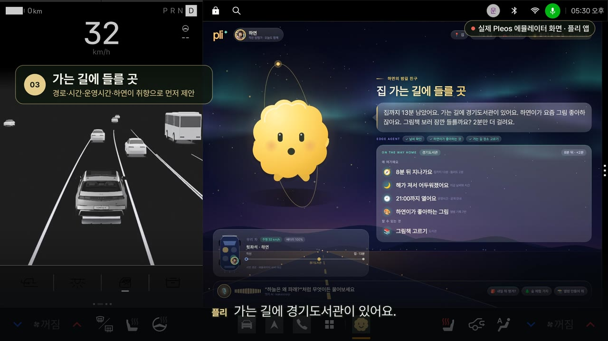</a></td></tr>
<tr><td align="center"><b>▶ 가로 1920×1080 · 41.3초</b> — <a href="docs/media/pli-film-landscape.mp4">docs/media/pli-film-landscape.mp4</a> · Pleos 화면 전체로 보는 하원길</td></tr>
<tr><td><a href="demo-v2/preview.mp4">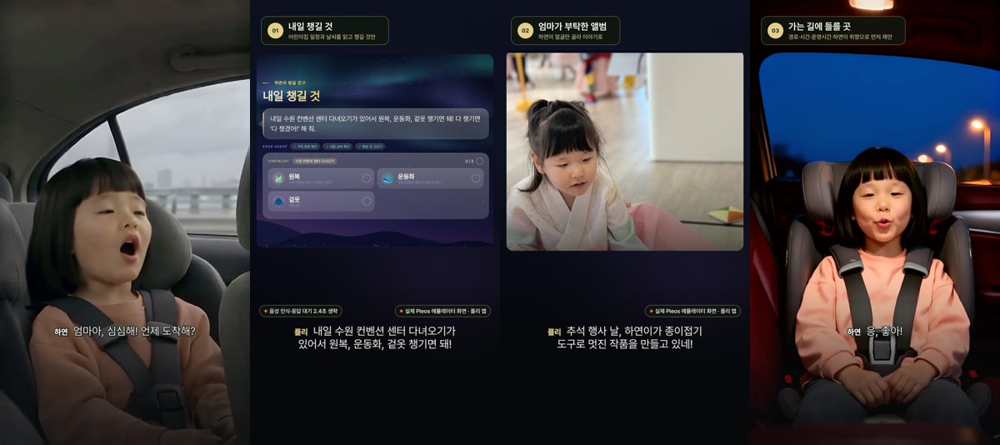</a></td></tr>
<tr><td align="center"><b>▶ 세로 1080×1920 · 41.0초</b> — <a href="demo-v2/preview.mp4">demo-v2/preview.mp4</a> · 칭얼거림 → 준비물 → 앨범 → “응, 좋아!”</td></tr>
</table>

- 가족 장면은 AI 영상 모델로 연출하고, **기능 장면(준비물·앨범·들를 곳)은 실제 Pleos 에뮬레이터에서 실제 APK를 녹화**했습니다.
- 영상도 소프트웨어처럼 검사합니다. 대사 받아쓰기 일치, 장면 경계의 말 잘림, 배경 잡음 튐, 얼굴 일치, 앱 화면 끊김(초당 다시 그림 수), AI가 배경에 잘못 그린 글자·물체 검출까지 **12개 자동 검사를 통과한 결과물**입니다. → [영상 제작 파이프라인](docs/manual/PRODUCT-FILM.md)

---

## 핵심 기능

| 기능 | 플리가 하는 일 | 근거·기술 |
|---|---|---|
| **내일 챙길 것** | 일정·준비물·날씨·목적지로 체크리스트, 말로 하나씩 체크 | MCP `get_calendar` · 날씨 · NaviHelper |
| **이야기 앨범** | 우리 아이가 나온 사진만 골라 쪽마다 이야기 | MCP `list_albums`/`get_album` · YuNet+SFace · 비전 LLM 캡션 |
| **가는 길 들를 곳** | 주행 중 먼저 제안 → 부모 승인 → 경유지 추가 | 경로 기하 · OSM 장소 팩 · Open-Meteo · `addWaypoint` |
| **무엇이든 질문** | “하늘은 왜 파래?” — 아이 말투로 짧고 정확하게 | 엣지 LLM Kanana 1.5 2.1B |
| **놀이** | 숫자(주판)·영어·숲 퀴즈, 끝말잇기(두음법칙)·수수께끼, 역할 바꾸기 | 엣지 놀이 엔진 · 검증된 문제 은행 |
| **차 이야기** | “언제 도착해?” “배터리 얼마나 남았어?” “밖에 비 와?” | Vehicle 신호 · 내비 남은 시간 · 와이퍼 |
| **부모 질문** | 일정·식단·알림장·공지를 존댓말로, 판단 근거와 함께 | 가족 서비스 MCP · 확인한 자료만 읽기 |
| **쉿 · 길 안내 양보** | 내비 음성이 나오면 즉시 멈춤, “쉿” 한마디면 조용히 | Android AudioFocus · 대화 상태 기계 |

전체 음성 명령은 [사용 설명서](docs/manual/USER-GUIDE.md#말해-보세요)에 있습니다.

---

## 기술 하이라이트

| 지표 | 결과 | 어떻게 |
|---|---|---|
| 플리가 말하는 동안 **Pleos 주행 화면** | **28~30 fps** (이전 8~13) | 주행 중 렌더 예산 `RenderBudget` — 무대 30fps, 음성 막대는 말할 때만, 제목·카드는 동작 없이 즉시 표시 |
| 플리 캐릭터 렌더링 | **58~59 fps** | Choreographer vsync + 하드웨어 캔버스, 소프트웨어 창과 분리 |
| 대기 중 메인 스레드 | **85% → 0%** | 0.1초마다 바뀌던 상태 갱신 제거 |
| 목소리 생동감 (음성 감정 모델 각성도) | **0.55 → 0.84** | 자주 하는 답은 상용 음성(MiniMax Speech 2.8 HD) 캐시, 받아쓰기로 발음 확인 |
| 자주 하는 답의 첫 소리 | **0.05~0.6 초** | 엣지 음성 캐시 · 새 답은 Supertonic 3 GPU 즉시 합성 |
| 엣지 음성 인식 지연 | **p50 168 ms** | SenseVoice int8 (sherpa-onnx, CPU) |
| 아동 음성 인식 벤치 | **0.928** | 높은 기본 주파수 보정 판독을 함께 만들어 더 깨끗한 쪽 선택 |
| 헤드유닛 음성 팩 | **201 MB · 원본 대비 0.06 dB** | fp16 저장, OTA 설치·해시 검증, 엣지가 끊겨도 말함 |
| 자동 검사 | **단위 78 · 기기 33 · 인수 27종** | 음성·차량·포털·엣지 AI·런타임 가드 |

측정 환경: RTX 4070 노트북 GPU(차량 엣지 역할) · 공식 Pleos Connect 2.1 에뮬레이터 · 2026-11.

---

## 아키텍처

헤드유닛 · 차량 엣지 · MCP 도구의 3계층입니다. 엣지가 없어도 앱은 헤드유닛 안의 음성 엔진과 규칙으로 계속 말합니다.

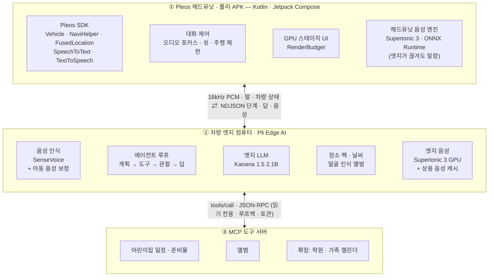

<details>
<summary><b>기획서의 아키텍처 · 에이전트 루프 · 경로 추천 슬라이드</b></summary>

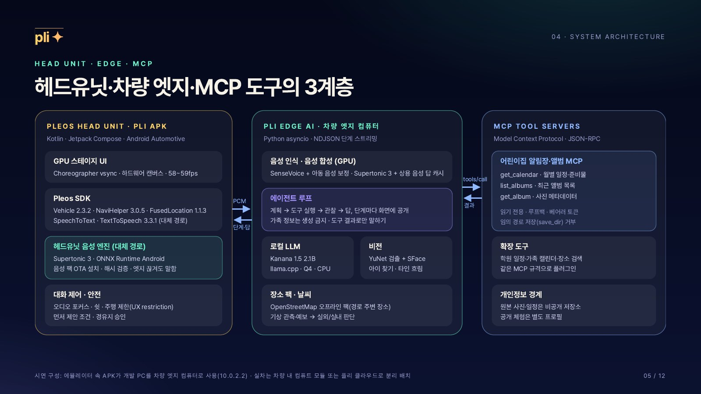
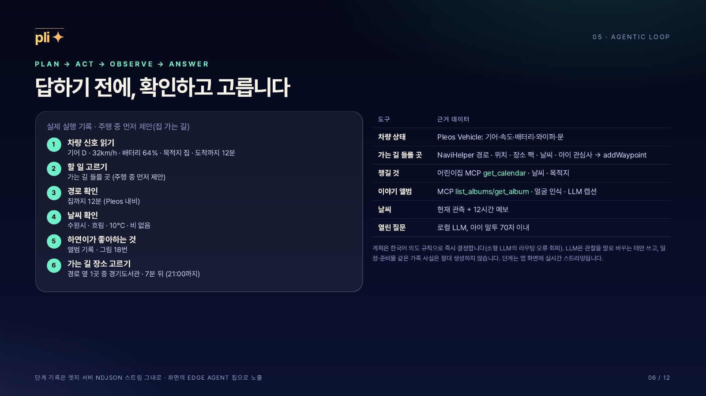
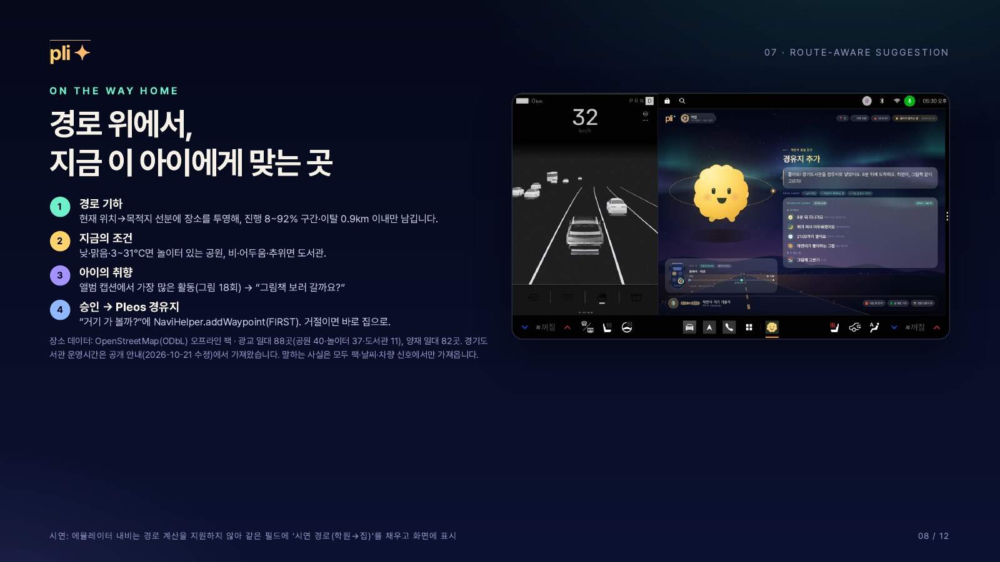

</details>

### 에이전트 루프 — 답하기 전에, 확인하고 고릅니다

```text
주행 중 먼저 제안 (집 가는 길, 실제 실행 기록)
 1  차량 신호 읽기    기어 D · 32km/h · 배터리 64% · 목적지 집
 2  할 일 고르기      가는 길 들를 곳 (대화가 비어 있고, 여정당 한 번)
 3  경로 확인        집까지 12분 (Pleos 내비)
 4  날씨 확인        수원시 · 흐림 · 10°C · 비 없음
 5  아이 취향        앨범 기록 · 그림 18회
 6  장소 고르기      경로 옆 후보 중 경기도서관 · 7분 뒤 · 21:00까지
 →  "가는 길에 경기도서관이 있어요. 하연이가 요즘 그림 좋아하잖아요. 그림책 보러 잠깐 들를까요?"
```

- **계획**은 한국어 의도 규칙으로 즉시 결정합니다(소형 LLM의 라우팅 오류 회피).
- **LLM은 관찰을 말로 바꾸는 데만** 씁니다. 일정·준비물·장소 같은 가족 사실은 절대 생성하지 않습니다.
- 각 단계는 엣지 서버의 NDJSON 스트림 그대로 앱 화면의 **EDGE AGENT 칩**으로 공개됩니다.

### MCP — 가족 서비스는 도구로, 에이전트는 규격으로 부릅니다

```text
→ {"method": "tools/call", "params": {"name": "get_calendar", "arguments": {"month": "2026-11"}}}
← "- 11/18(수) · <지역사회연계활동 '수원 컨벤션 센터 다녀오기'> · … · 준비물 : 원복, 운동화"
⇒ 플리: "내일 수원 컨벤션 센터 다녀오기가 있어서 원복, 운동화, 겉옷 챙기면 돼!"   (날씨: 내일 아침 쌀쌀 → 겉옷)
```

읽기 전용 도구만 공개 · 127.0.0.1 루프백 · 베어러 토큰 · 임의 저장 경로 거부 · 응답 캐시 10분 · 실패하면 “확인하지 못했어요”라고 정직하게 말합니다. 학원 일정·가족 캘린더·장소 검색도 같은 규격의 도구로 붙습니다.

---

## Pleos SDK 연동

| SDK | 버전 | 플리가 쓰는 곳 |
|---|---|---|
| **Vehicle** | 2.3.2 | 기어·속도로 출발·주행 판단, 와이퍼로 비 이야기, 2열 문, 배터리·충전 |
| **NaviHelper** | 3.0.5 | 목적지·남은 시간, 도착 이벤트, 경로 요청, `addWaypoint` |
| **FusedLocation** | 1.1.3 | 현재 위치 → 날씨·경로 주변 장소 |
| **SpeechToText** | 3.3.1 | 엣지 인식이 없을 때의 차량 내 인식 (ON_DEVICE) |
| **TextToSpeech** | 3.3.1 | 온디바이스 음성의 마지막 대체 경로 |

패키지 `ai.teammoon.pli` · minSdk 28 / targetSdk 35 · `arm64-v8a`, `x86_64` · 검증 환경 Pleos Connect 2.1 (Android 14).

---

## 안전과 개인정보, 설계부터

| 로컬 우선 | 사실만 말하기 | 보호자 승인 | 주의 분산 최소화 |
|---|---|---|---|
| 음성 인식·LLM·얼굴 인식·장소 선택은 엣지에서. 원본 사진은 비공개 폴더(권한 700/600), EXIF 제거, 마이크 원본 녹음은 보관하지 않습니다 | 일정·준비물·장소는 도구 결과로만. 모르면 “확인하지 못했어요”. 위험한 요청은 부드럽게 거절하고 놀이로 돌립니다 | 경로 변경은 부모의 한마디 승인 뒤에만. 먼저 제안은 여정당 한 번, 대화가 비어 있고 주행 중일 때만 | 내비 안내가 나오면 즉시 양보, “쉿”이면 다시 부를 때까지 조용히. 주행 중엔 화면 동작을 줄이고 음성 중심 |

공개 체험은 별도 프로필에서 샘플 자료만 씁니다. 가족 개인 자료는 공개 화면에 쓰지 않습니다.

---

## 빠른 시작

**설치 없이 체험** — 시연 포털의 `/app`(음성 앱), `/pleos`(실제 Pleos 화면), `/resources`(영상·기획서). 순서는 [심사 시연 가이드](docs/manual/DEMO-GUIDE.md)를 따라 주세요.

**직접 빌드·실행** (Linux · KVM · JDK 17 · Python 3)

```sh
./pleos setup            # Android SDK · 공식 Pleos 에뮬레이터 이미지 · 한국어 모델 (최초 수 GB)
./pleos doctor           # 준비 상태 확인
./pleos test             # 단위 테스트 78개
./pleos run --release    # 빌드 → Pleos 에뮬레이터 → 설치 → 실행
deploy/install-edge-services.sh   # (선택) 차량 엣지 AI: LLM · 에이전트 · 음성
```

자세한 절차와 문제 해결은 [설치·실행 가이드](docs/manual/INSTALL.md)에 있습니다.

---

## 저장소 구조

```text
.
├── android/                     플리 APK (Kotlin · Jetpack Compose)
│   └── app/src/main/java/ai/teammoon/pli/
│       ├── voice/               듣기 · 말하기 · 대화 제어 (Pleos STT/TTS, 엣지 음성, 헤드유닛 엔진)
│       ├── vehicle/             Pleos Vehicle · NaviHelper · FusedLocation
│       ├── edge/                엣지 AI 클라이언트 (NDJSON 단계 스트림)
│       ├── domain/              의도 해석 · 카드 · 여정 · 렌더 예산
│       ├── data/                기기 내 저장 · 가족 문서 · 계획안 가져오기
│       └── ui/                  GPU 스테이지 · 차량 패널 · 경험 화면
├── scripts/
│   ├── pleos.py                 ./pleos 개발 CLI (setup · build · run · test · demo …)
│   ├── edge_*.py                차량 엣지 AI (ASR · 에이전트 · 장소 · 날씨 · 놀이 · 음성)
│   ├── *mcp*                    가족 서비스 MCP 서버 (Node, JSON-RPC)
│   ├── demo-*.py, public-*.py   시연 포털 · 에뮬레이터 런타임 · 공개 터널
│   └── film_*.py, *-film.py     제품 영상 파이프라인 (계획 · 녹화 · 검사 · 조립)
├── demo-v2/                     시연 웹 포털 (/app · /pleos · /resources)
├── deploy/                      엣지 AI systemd 템플릿 · 설치 스크립트 · 고정 패키지 버전
├── qa/native/                   인수 검사 27종 · 검사 도구 · 고정 입력(합성 음성)
├── media/pli-film/              제품 영상 계획 (장면 · 대사 · 편집 · 앱 촬영 대본)
├── docs/                        기획서 · 매뉴얼 · 이미지 · 영상 · 고지
└── pleos                        개발 CLI 진입점
```

---

## 품질 검증

| 계층 | 무엇을 | 실행 |
|---|---|---|
| 단위 | 음성 의도·채점·카드·여정·차량 신호 건강도·렌더 예산 (78개) | `./pleos test` |
| 기기 | 오디오 포커스·수명주기·권한·저장 계약 (33개, 에뮬레이터) | Gradle `connectedAndroidTest` |
| 인수 | 실제 Chrome 마이크 → APK 인식·답·차량 상태·소리 출력, 포털 성능, 엣지 AI 정확도·지연, MCP 계약, 런타임 복구 (27종) | `python3 qa/native/run-acceptance.py --only <이름>` |
| 영상 | 길이·대사·말 잘림·얼굴·음량·잡음·앱 화면 끊김·조명·배경 결함 (12항목) | `scripts/check-film.py` |

`run-acceptance.py`는 인자 없이 실행하면 검사 계획만 보여 주고 기기를 띄우지 않습니다.

---

## 로드맵

- 실차 헤드유닛에서 음성 인식·합성 지연 측정
- 엣지 계층의 차량 내 컴퓨트 모듈 / 플리 클라우드 배치 결정
- 처음 듣는 답도 같은 상용 음성으로 — 스트리밍 합성으로 음색 일치
- 경로 기반 장소 팩 자동 갱신, 실제 부모·아이 발화와 실내 소음 평가

---

## 고지

- 사용한 SDK·모델·데이터·폰트의 출처와 라이선스: [docs/THIRD-PARTY.md](docs/THIRD-PARTY.md)
- Pleos SDK는 Pleos Playground 공식 배포본이며 각 SDK의 이용 조건을 따릅니다.
- APK는 이 저장소에서 만든 개발 키로 서명합니다(대회 시연·로컬 설치용). 마켓 배포 시 정식 서명 키를 적용합니다.
- 모델 파일·SDK·빌드 결과·가족 자료는 저장소에 넣지 않습니다. `./pleos setup`과 [설치 가이드](docs/manual/INSTALL.md)로 재현합니다.

<div align="center">

**© 2026 TEAM MOON** · 플리 Pli — Pleos Connect 차량용 가족 AI 에이전트

</div>
