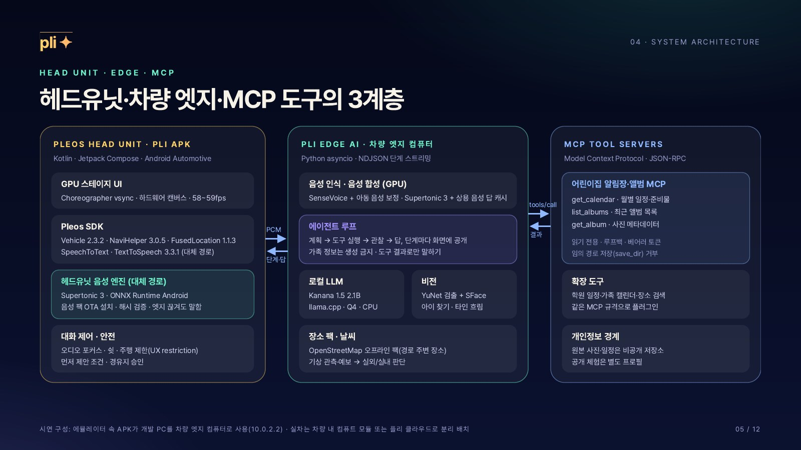
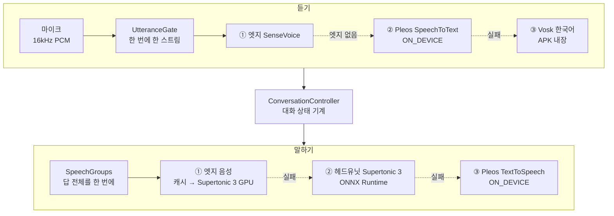
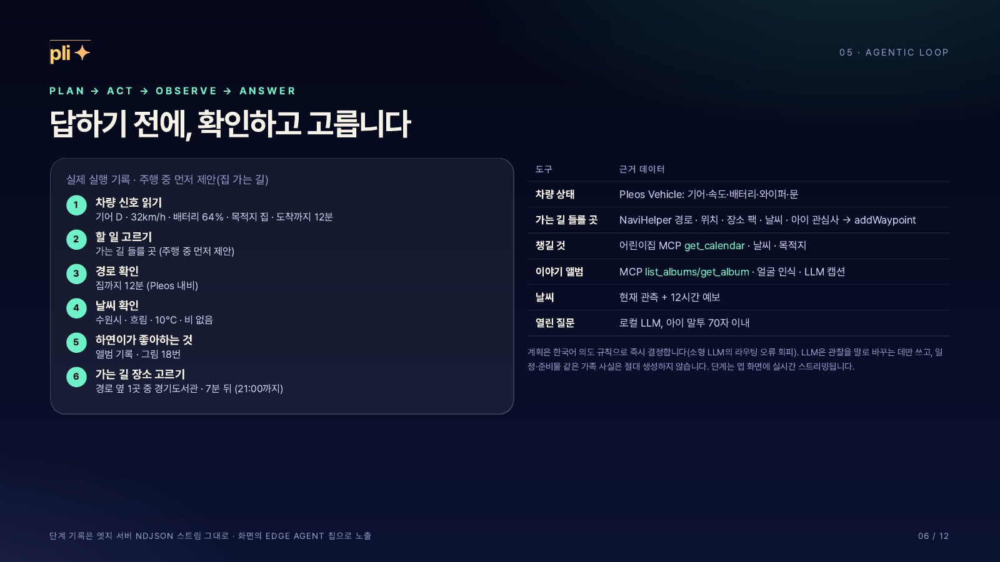
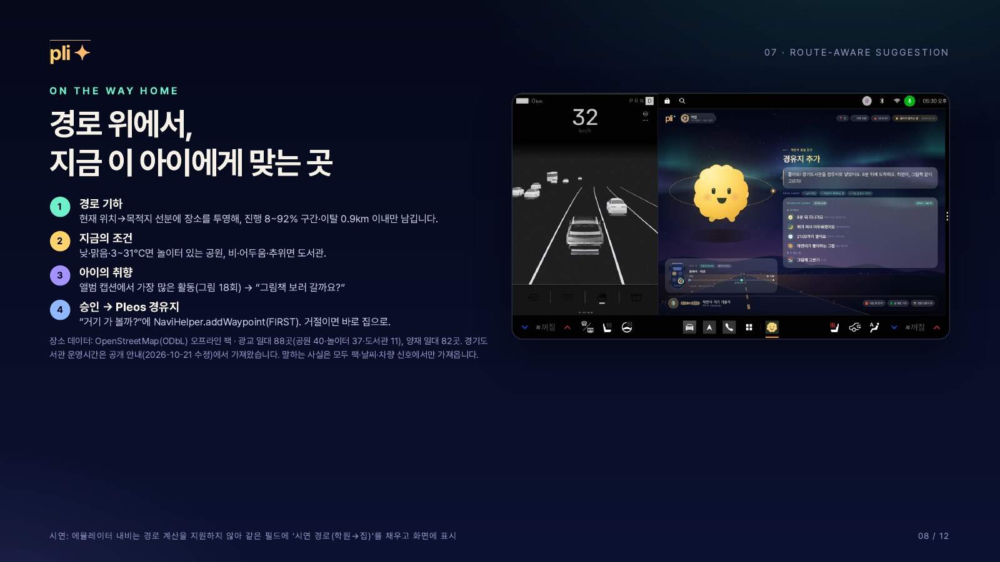

# 기술 문서 — 플리의 구조

> 질문에 답하는 챗봇이 아니라, **차를 읽고 먼저 움직이는 동승자**.
> 이 문서는 그 동승자를 헤드유닛 · 차량 엣지 · MCP 도구의 세 계층으로 어떻게 만들었는지 설명합니다.

**목차**
[1. 설계 원칙](#1-설계-원칙) · [2. 3계층 구조](#2-3계층-구조) · [3. 앱 내부](#3-앱-내부) · [4. 음성 파이프라인](#4-음성-파이프라인) · [5. 에이전트 루프](#5-에이전트-루프) · [6. MCP 도구](#6-mcp-도구) · [7. 경로 위 추천](#7-경로-위-추천) · [8. 렌더링 예산](#8-렌더링-예산) · [9. 얼굴 인식 앨범](#9-얼굴-인식-앨범) · [10. 개인정보·안전 경계](#10-개인정보안전-경계) · [11. 측정값](#11-측정값) · [12. 한계와 다음 단계](#12-한계와-다음-단계)

---

## 1. 설계 원칙

| 원칙 | 의미 | 구현 |
|---|---|---|
| **Eyes-free** | 운전자는 말로만 | 핵심 흐름 전체가 터치 없이 완결. 경로 변경 같은 확인도 “거기 가 볼까?” 같은 자연스러운 대화로 승인 |
| **Proactive** | 차량 신호가 트리거 | 주행 속도·남은 시간·경로·대화 공백이 조건을 만족할 때만 플리가 먼저 말함. 여정당 한 번 |
| **Seat-aware** | 운전석과 뒷좌석 | 부모에게는 존댓말로 판단 근거를, 아이에게는 반말로 놀이를 |
| **Yields** | 길 안내가 먼저 | 내비 음성이 나오면 Android 오디오 포커스로 즉시 멈춤, “쉿” 한마디면 조용히 |

화면은 목소리를 돕는 보조 수단입니다. Pleos 왼쪽 차량 화면을 가리지 않고, 플리 화면에는 **우리 차** 패널(뒷좌석 아이·기어·속도·배터리·경로와 들를 곳)을 실시간으로 그립니다.

---

## 2. 3계층 구조



| 계층 | 실행 위치 | 맡은 일 | 끊기면 |
|---|---|---|---|
| **헤드유닛 · 플리 APK** | Pleos Connect (Android 14) | 대화 제어, Pleos SDK, 화면, 헤드유닛 음성 엔진 | — |
| **차량 엣지 · Pli Edge AI** | 차량 내 컴퓨트 모듈(시연에서는 개발 PC, 에뮬레이터에서 `10.0.2.2`) | 음성 인식, 에이전트 루프, LLM, 엣지 음성, 얼굴 인식, 장소·날씨 | 앱이 Pleos STT·헤드유닛 음성 엔진·기기 안 규칙으로 자동 전환 |
| **MCP 도구 서버** | 엣지 루프백 | 어린이집 일정·준비물·앨범 등 가족 서비스 | “확인하지 못했어요”라고 정직하게 답함 |

모든 엣지 서비스는 127.0.0.1에서만 열리고, 앱의 모든 엣지 호출에는 시간 제한이 있습니다. 실패하면 일정 시간 엣지를 쓰지 않고 헤드유닛 쪽으로 넘어갑니다.

---

## 3. 앱 내부

Kotlin · Jetpack Compose · 패키지 `ai.teammoon.pli`.

| 패키지 | 책임 | 주요 클래스 |
|---|---|---|
| `voice/` | 듣기·말하기·대화 상태 기계. 음성 SDK는 별도 `:voice` 프로세스에서만 실행 | `ConversationController` · `PliSpeaker` · `PleosSpeechListener` · `EdgeVoice` · `PliVoiceEngine` · `SpeechGroups` · `UtteranceGate` |
| `vehicle/` | Pleos Vehicle · NaviHelper · FusedLocation 연결과 구독 | `PleosVehicleSource` · `VehicleService` · `VehicleConnection` |
| `edge/` | 엣지 AI 클라이언트 (ASR · 에이전트 NDJSON 단계 스트림 · 앨범) | `EdgeAi` |
| `domain/` | 의도 해석, 카드, 여정, 차량 신호 건강도, 렌더 예산 | `VoiceInterpreter` · `StageCards` · `JourneyExperience` · `VehicleSignalHealth` · `RenderBudget` |
| `data/` | 기기 내 저장, 가족 문서, 놀이계획안 OCR 가져오기, 세션 기록 | `PliStore` · `FamilyDocuments` · `PlanImporter` · `SessionJournal` |
| `ui/` | GPU 스테이지(캐릭터·배경), 차량 패널, 경험 화면 | `StageSurface` · `StageBackdrop` · `FrameLoop` · `PliStage` · `CarPanel` |

**차량 신호는 읽기만 하고 추측하지 않습니다.** `VehicleSignalHealth`는 서비스의 심장 박동이 아니라 실제 속성 읽기가 끝난 시각으로 신호의 신선도를 판단합니다(완료 후 10초, 미완료 15초가 지나면 오래된 신호). 신호가 없으면 “모른다”고 말합니다.

---

## 4. 음성 파이프라인



**듣기**
- 앱이 소유한 16kHz PCM을 엣지 SenseVoice(int8, sherpa-onnx)로 보냅니다. p50 168ms.
- 아이 목소리는 기본 주파수가 높아 인식이 흔들립니다. 스펙트럼을 성인 쪽으로 보정한 판독을 함께 만들어 더 깨끗한 쪽을 고릅니다(아동 음성 벤치 0.928).
- 엣지가 없으면 Pleos SpeechToText(ON_DEVICE), 그것도 실패하면 APK에 포함한 Vosk 한국어 모델로 넘어갑니다(`PleosSpeechListener` → `OfflineListener`).

**말하기**
- 답 전체를 한 번에 합성합니다(4문장 176ms). 문장 사이 쉼이 0.3초를 넘지 않아 낭독체가 아니라 대화체로 들립니다.
- 엣지 음성 서버는 요청 문장의 `sha256(text)[:24]`로 **생기 있는 답 캐시**를 먼저 찾습니다. 자주 하는 답은 상용 음성 MiniMax Speech 2.8 HD로 미리 만들어, Whisper 받아쓰기(일치 ≥ 0.9)와 음성 감정 모델로 검사한 녹음입니다. 캐시가 없으면 Supertonic 3이 GPU에서 즉시 합성하고, 그 문장을 다음에 만들 목록에 넣습니다. 응답 헤더 `X-Voice-Source`가 출처를 알려 줍니다.
- 엣지가 끊기면 헤드유닛 안의 Supertonic 3(ONNX Runtime Android)이 말합니다. 음성 팩(201MB, fp16 저장)은 APK와 분리해 엣지에서 한 번 받아 해시로 검증하며, fp32 원본과의 차이는 0.055dB(log-mel)입니다.
- 마지막 대체 경로는 Pleos TextToSpeech입니다. 모든 경로가 같은 이벤트 계약(start → done/stop)을 따르므로 오디오 포커스·쉿·완료 감시가 그대로 적용됩니다.
- 숫자는 “두 가지 · 이십 분”처럼 한국어로 읽습니다(`KoreanReading`).

**생동감을 숫자로 고른 목소리**

| 목소리 | 각성도 (audeering) | 비고 |
|---|---|---|
| Supertonic 3 F3 1.4배 (실시간) | 0.53~0.57 | 음질 좋지만 낭독체 |
| CosyVoice3 ‘들뜨게’ | 0.77 | 이 GPU에서 실시간의 약 2배 시간 |
| **MiniMax Speech 2.8 HD Exuberant_Girl** | **0.84** (0.75~0.92) | 자주 하는 답 17문장, 받아쓰기 17/17 |
| 사람이 연기한 엄마 대사 (비교) | 0.65 | |

---

## 5. 에이전트 루프



```text
요청(말 또는 차량 트리거)
  → 계획(Plan)     한국어 의도 규칙으로 즉시 결정
  → 도구 실행      차량 신호 · 내비 · 날씨 · 장소 팩 · MCP · 앨범 · 놀이 엔진
  → 관찰           도구 결과만 모음 (가족 사실은 생성 금지)
  → 답            LLM은 관찰을 아이 말투로 바꾸는 데만 사용 (70자 안팎)
  ↳ 단계마다 NDJSON으로 스트리밍 → 앱의 EDGE AGENT 칩
```

| 계획 | 하는 일 |
|---|---|
| `prepare` | 일정·공지 + 날씨 + 목적지 → 챙길 것 체크리스트 |
| `stop` | 주행 중 먼저 제안(경로 위 장소), 승인 시 경유지 |
| `route` · `destinations` | 목적지 맞춤 가는 길 놀이·도착 후 할 일, 주말 목적지 후보 |
| `weather` · `vehicle_status` | 실시간 날씨·와이퍼, 배터리·남은 시간 |
| `family_news` | 일정·식단·알림장·공지 — 앱의 검증된 자료 경로로 위임 |
| `make_album` · `show_album` | 얼굴 인식 이야기 앨범 |
| `start_game` · `game_turn` | 끝말잇기(두음법칙)·수수께끼 등 엣지 놀이 엔진 |
| `answer` | 열린 질문 → 엣지 LLM |
| `remember` · `quiet` · `show_growth` | 기억하기, 쉿, 성장 기록 |

**왜 계획을 규칙으로?** 2B급 소형 LLM은 도구 선택(라우팅)에서 틀리는 일이 잦습니다. 계획은 결정적인 한국어 의도 규칙으로 즉시 정하고, LLM은 관찰을 자연스러운 말로 바꾸는 데만 씁니다. 그래서 일정·준비물·장소 같은 사실은 항상 도구 결과에서 나옵니다.

---

## 6. MCP 도구

가족 서비스마다 다른 API를 같은 `tools/call` 규격(JSON-RPC)으로 감쌉니다. 에이전트 코드는 그대로 두고 도구만 추가하면 기능이 늘어납니다.

| 도구 | 반환 |
|---|---|
| `get_calendar(month)` | 월별 일정과 “준비물 :” 줄 |
| `list_albums` | 최근 앨범 목록 |
| `get_album` | 사진 메타데이터 → 비공개 폴더로 동기화 후 얼굴 인식 |

```text
→ {"method":"tools/call","params":{"name":"get_calendar","arguments":{"month":"2026-11"}}}
← "- 11/18(수) · <지역사회연계활동 '수원 컨벤션 센터 다녀오기'> · … · 준비물 : 원복, 운동화"
⇒ "내일 수원 컨벤션 센터 다녀오기가 있어서 원복, 운동화, 겉옷 챙기면 돼!"   (겉옷: 날씨 규칙, 내일 아침 기온)
```

**지키는 것**: 읽기 전용 도구만 공개 · 127.0.0.1 루프백 · 베어러 토큰 · 임의 저장 경로(`save_dir`) 거부 · 응답 캐시 10분 · 실패 시 “확인하지 못했어요”. 서버는 Node로 구현했고, 앨범 동기화 스크립트가 같은 모듈을 재사용합니다. 학원 일정·가족 캘린더·장소 검색도 같은 규격의 도구로 붙습니다.

---

## 7. 경로 위 추천



1. **경로 기하** — 현재 위치 → 목적지 선분에 후보 장소를 투영해, 진행 **8~92%** 구간이면서 경로에서 **0.9km 이내**인 곳만 남깁니다.
2. **지금의 조건** — 위치로 계산한 일출·일몰과 실시간 날씨로, 낮·맑음·3~31°C면 놀이터 있는 공원, 비·어두움·추위면 도서관.
3. **운영 시간** — 도착 후 **40분 이상** 머물 수 있게 열려 있는 곳만. 운영 시간 정보가 없는 곳은 10:00~17:00 사이에만 후보로 둡니다.
4. **아이의 취향** — 앨범 캡션에서 가장 많은 활동(그림 18회) → “그림책 보러 갈까요?”
5. **승인 → Pleos 경유지** — “거기 가 볼까?”에 `NaviHelper.addWaypoint(FIRST)`. 거절이면 바로 집으로.

**먼저 말하는 조건** (`ConversationController.maybeOfferStop`, 2.5초마다 확인)

| 조건 | 값 |
|---|---|
| 속도 | 10km/h 이상 |
| 남은 시간 | 5분 이상 |
| 대화 공백 | 마지막 재생·마지막 발화 후 6초 이상 |
| 상태 | 대화 중·쉿·내비 안내·놀이·카드·앨범·읽기 중이 아닐 때 |
| 빈도 | 여정당 한 번 |
| 근거 | 목적지·현재 위치·엣지 상태가 모두 확인될 때 |

장소 데이터는 OpenStreetMap(ODbL) 오프라인 팩입니다. 광교 일대 88곳(공원 40·놀이터 37·도서관 11), 양재 일대 82곳. 말하는 사실은 모두 팩·날씨·차량 신호에서만 가져옵니다.

---

## 8. 렌더링 예산

Pleos 헤드유닛은 하나의 디스플레이(2560×1440)를 차량 화면과 앱이 나눠 씁니다. 플리가 화면을 다시 그릴 때마다 디스플레이 전체가 다시 합성되므로, **앱의 그리기 비용은 곧 차량 화면의 부드러움**입니다.

| 구성 | 방식 |
|---|---|
| 캐릭터·밤하늘 무대 | `SurfaceView` + Choreographer vsync + 하드웨어 캔버스 (58~59fps) |
| 글·카드 | 소프트웨어 창. 대화 상태가 바뀔 때만 다시 그림 |
| 대기 중 메인 스레드 | 0.1초마다 바뀌던 마이크 음량 상태 등 의미 없는 갱신 제거 → 85% → 0% |

**주행 중 렌더 예산** (`domain/RenderBudget.kt`)

| 항목 | 정차 | 주행·운전 제한 |
|---|---|---|
| 무대(캐릭터·배경) | 30fps | 12fps (캐릭터 입은 계속 움직임) |
| 음성 막대 | 듣기·말하기 중 30fps, 그 외 2fps | 같음 |
| 답 글자 | 한 글자씩 타이핑 | 한 번에 표시 |
| 카드·제목·화면 전환 | 등장 애니메이션 | 애니메이션 없이 즉시 |

**결과**: 플리가 답하는 동안 Pleos 차량 화면 **초당 8~13번 → 28~30번**(대기 28.6번), 플리 한 프레임 그리기 15.7/19.8ms → 0.9ms. 판단 함수 `RenderBudget.driving()` · `calm()` · `stageFps()` · `waveFps()`는 단위 테스트로 고정되어 있습니다.

---

## 9. 얼굴 인식 앨범

```text
비공개 사진 폴더 (700/600)
  → YuNet 얼굴 검출 → SFace 신원 비교 (기준 사진 대비, 단체 사진은 ≥ 0.72의 더 엄격한 기준)
  → 우리 아이 사진만 선택, 다른 얼굴은 모두 흐림, EXIF 제거
  → 비전 언어 모델(llama.cpp mtmd)이 장면 설명 → 이야기 쪽마다 캡션
  → .tools/edge-ai/family-album (엣지 전용, APK·저장소·공개 자료에 넣지 않음)
```

앨범 캡션은 아이 취향(가장 많은 활동)을 계산하는 데도 쓰여 경로 위 추천으로 이어집니다.

---

## 10. 개인정보·안전 경계

| 경계 | 방법 |
|---|---|
| 로컬 우선 | 음성 인식·LLM·얼굴 인식·장소 선택은 엣지에서. 외부 클라우드 LLM 호출 없음 |
| 원음 미저장 | 마이크 원본 녹음을 저장하지 않음. 브라우저 시연도 종료 시 트랙과 APK 마이크 해제 |
| 사실만 말하기 | 가족 사실은 도구 결과로만, 모르면 “확인하지 못했어요” |
| 보호자 승인 | 경로 변경은 부모 승인 뒤에만, 공개 체험은 실제 경로 변경 차단 |
| 프로필 분리 | 개인(personal)과 공개(public) 에뮬레이터·포털을 분리, 공개는 샘플 자료만 |
| 위치 최소화 | 날씨 조회에는 약 1km 단위로 줄인 위치만 |
| 비밀 정보 | 계정 정보·토큰은 `.tools/private/`(권한 700)에만, 저장소·APK에 넣지 않음 |

---

## 11. 측정값

| 항목 | 값 | 측정 |
|---|---|---|
| 답하는 동안 Pleos 차량 화면 | 28~30fps (이전 8~13) | 화면 녹화에서 차량 화면 영역이 바뀐 횟수/초, 2026-11-15 |
| 플리 캐릭터 | 58~59fps | 기기 계측 |
| 엣지 음성 인식 | p50 168ms | `/v1/health` |
| 자주 하는 답 첫 소리 | 0.05~0.6s | 캐시 50~57ms, 실시간 합성 문장당 |
| 목소리 생동감 | 0.84 (Supertonic 0.55) | audeering wav2vec2 각성도 |
| 아동 음성 인식 벤치 | 0.928 | 고정 합성 음성 세트 |
| 음성 팩 | 201MB, 0.055dB | fp32 대비 log-mel 거리 |
| 시험 | 단위 78 · 기기 33 · 인수 27종 | `./pleos test`, `run-acceptance.py` |

측정 환경: RTX 4070 노트북 GPU(엣지 역할) · 공식 Pleos Connect 2.1 에뮬레이터 · 같은 호스트에서 다른 작업과 CPU를 나눠 쓰는 조건.

---

## 12. 한계와 다음 단계

| 지금 (시연 한정) | 다음 |
|---|---|
| 엣지 AI는 개발 PC가 차량 엣지 컴퓨터 역할 (`10.0.2.2`) | 차량 내 컴퓨트 모듈 / 플리 클라우드 배치 결정 |
| 에뮬레이터 내비가 경로를 계산하지 않아 같은 필드에 ‘시연 경로(학원 → 집)’를 채움 | 실차 헤드유닛에서 경로·음성 지연 측정 |
| 캐시에 없는 새 답은 Supertonic 음색으로 먼저 나감 | 같은 상용 음성의 스트리밍 합성으로 음색 일치 |
| 장소 팩은 광교·양재 일대 | 경로 기반 타일 자동 갱신 |
| 합성 음성으로 인식 시험 | 실제 부모·아이 발화와 실내 소음 평가 |
