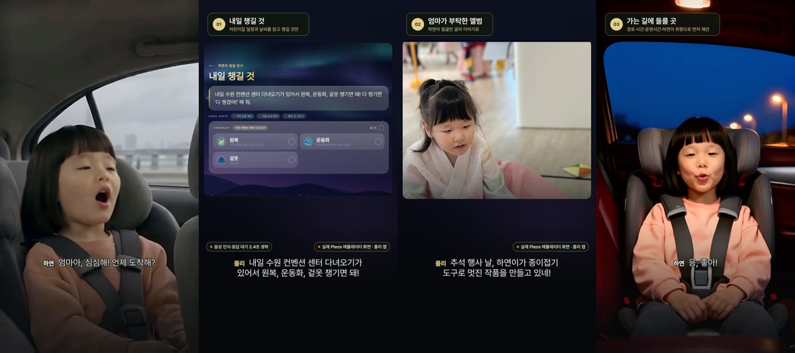
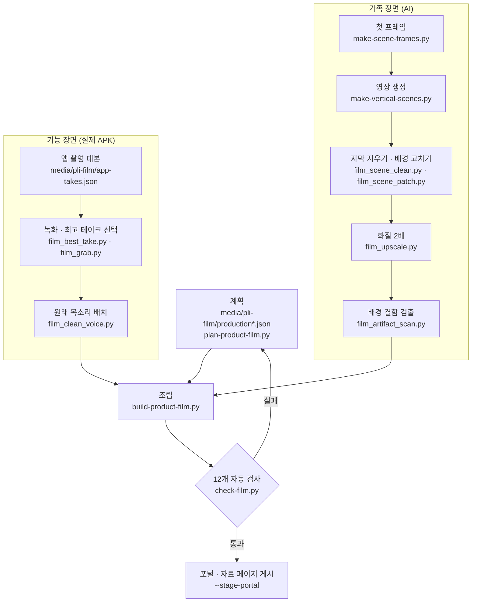

# 제품 영상 제작 파이프라인

> 제품 영상도 코드처럼 만들고, 코드처럼 검사합니다.
> 계획은 JSON, 장면은 재현 가능한 스크립트, 결과물은 12개 자동 검사를 통과해야 공개됩니다.

| 결과물 | 형식 | 길이 |
|---|---|---|
| 가로 — [YouTube](https://youtu.be/-pdkkt0xf9g) · [원본](../media/pli-film-landscape.mp4) | 1920×1080 · 30fps · Pleos 화면 전체 | 41.3초 |
| 숏폼 — [YouTube Shorts](https://youtube.com/shorts/rMiUogxPUHY) · [원본](../../demo-v2/preview.mp4) | 1080×1920 · 30fps · 플리 카드 클로즈업 | 41.0초 |



---

## 원칙

- **기능 장면은 실제 화면만** — 준비물·앨범·들를 곳 장면은 Pleos 에뮬레이터에서 실제 APK가 실제 음성을 듣고 답한 화면을 원본 해상도(2560×1440)로 녹화했습니다. 화면에 “실제 Pleos 에뮬레이터 화면 · 플리 앱” 표시를 붙입니다.
- **플리의 목소리는 앱이 실제로 낸 소리** — 엣지 음성 서버가 앱에 보낸 문장을 그대로 기록(음성 일지)해 영상에 배치합니다. 에뮬레이터 스피커의 끊김이 섞이지 않습니다.
- **가족 장면은 AI 연출** — 가족 사진을 기준으로 만든 첫 프레임과 대사 음성으로 영상 모델이 입 모양까지 맞춘 장면을 만듭니다.
- **정지 이미지 대체 금지** — 계획과 일치하는 장면·앱 촬영본이 없으면 빌드가 거절합니다.

---

## 흐름



---

## 12개 자동 검사 (`scripts/check-film.py`)

| 검사 | 기준 |
|---|---|
| `length` | 30~60초 |
| `cutSpeech` | 장면 경계 0.12초 안에 말소리가 걸리지 않음 (말 잘림 없음) |
| `dialogue` | 각 가족 대사를 그 장면 소리에서 받아써 자막과 일치 |
| `appFrames` | 앱 촬영본이 30fps 고정 슬롯, 멈춘 슬롯 ≤ 2% |
| `faces` | 가족 장면 속 아이 얼굴이 실제 사진과 일치 (중앙값 ≥ 0.45) |
| `loudness` | 말소리 크기 차 3 LU 이내 |
| `noiseFloor` | 장면이 바뀔 때 배경 잡음 튐 ≤ 8 dB |
| `clock` | 앱 촬영이 이야기의 평일 17:30 시계로 녹화됨 |
| `appMotion` | 앱 장면마다 Pleos 차량 화면이 초당 15번 이상 다시 그려짐 (끊김 없음) |
| `voiceDrops` | 플리 소리에 단어 중간의 끊김 없음 |
| `lighting` | 차 안 장면들의 밝기·색온도가 같은 저녁으로 이어짐 |
| `drawnDefects` | AI가 배경에 잘못 그린 글자·갑자기 나타나는 물체가 남지 않음 |

v10 결과: 두 버전 모두 12/12 통과 — 앱 장면 Pleos 차량 화면 초당 28~30번, 잡음 튐 최대 6.5 / 7.0 dB, 말소리 크기 차 2.4 / 2.5 LU.

### AI가 잘못 그린 것을 잡는 검출기 (`film_artifact_scan.py`)

영상 모델은 배경에 엉터리 글자, 화면 달린 차 키, 갑자기 생기는 흰 점 같은 것을 그립니다. 세 가지 검출을 합칩니다.

1. **글자 검출** — 화면 전체에 PP-OCRv3 텍스트 검출.
2. **갑자기 나타나는 물체** — 정지 배경을 첫 0.5초와 비교. 사람은 Mask R-CNN으로 제외하고, 작고 날카로운 변화도 잡습니다.
3. **비전 언어 모델 점검표** — 프레임마다 예/아니오 6문항(글자가 있는가, 화면 달린 물건이 있는가 …). “결함을 찾아라”는 열린 질문은 놓쳤고, 점검표 방식이 잡아냈습니다.

찾은 결함은 정지 배경을 깨끗한 판으로 덮거나 꺼진 화면처럼 어둡게 고치고(`film_scene_patch.py`), 사람은 BiRefNet 인물 매트로 보호합니다.

---

## 실행

```sh
# 1) 계획 (세로 / 가로)
.tools/edge-venv/bin/python scripts/plan-product-film.py
PLI_FILM_VARIANT=landscape .tools/edge-venv/bin/python scripts/plan-product-film.py

# 2) 기능 장면 녹화 — 각 장면을 여러 번 찍어 차량 화면이 가장 부드러운 테이크를 고름
PLI_FILM_STREAM=1920x1080 python3 scripts/film_best_take.py pack 3 --clock '2026-11-17 17:30' --night

# 3) 조립과 검사
.tools/edge-venv/bin/python scripts/build-product-film.py
.tools/edge-venv/bin/python scripts/check-film.py
PLI_FILM_VARIANT=landscape .tools/edge-venv/bin/python scripts/build-product-film.py
PLI_FILM_VARIANT=landscape .tools/edge-venv/bin/python scripts/check-film.py

# 4) 검토한 렌더만 포털에 반영 (계획·영상 해시가 일치해야 함)
python3 scripts/build-product-film.py --stage-portal
python3 scripts/build-portal-assets.py --publish
```

| 파일 | 내용 |
|---|---|
| `media/pli-film/production.json` · `production-landscape.json` | 장면·컷 길이·대사·자막·라벨·음향·검토 기록 |
| `media/pli-film/app-takes.json` | 앱 촬영 대본: 대사, 차량 동작(예: 출발), 기다릴 앱 상태 |
| `scripts/film_*.py` | 녹화·음성·자막·라벨·엔드카드·검사 모듈 |

배경 음악·차량 소음·알림음은 `film_audio.py`가 직접 합성하고, 엔드카드는 앱 아이콘 벡터로 `film_endcard.py`가 그립니다. 사용한 생성 모델과 도구는 [THIRD-PARTY](../THIRD-PARTY.md)에 적었습니다.
