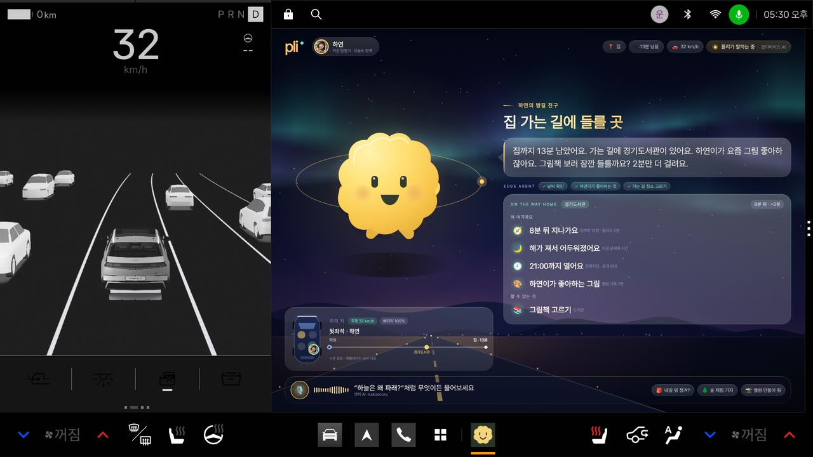

# 플리 사용 설명서

> 플리는 화면을 누르지 않고 **말로** 쓰는 차량용 가족 AI입니다.
> 아이에게는 함께 노는 친구, 부모에게는 일정과 준비물을 챙기는 작은 도움이 됩니다.

**목차**
[1. 시작하기](#1-시작하기) · [2. 화면 구성](#2-화면-구성) · [말해 보세요](#말해-보세요) · [3. 하원길 따라 하기](#3-하원길-따라-하기) · [4. 부모를 위한 기능](#4-부모를-위한-기능) · [5. 주행 중의 플리](#5-주행-중의-플리) · [6. 개인정보](#6-개인정보) · [7. 문제 해결](#7-문제-해결)

---

## 1. 시작하기

1. Pleos 앱 목록에서 **플리**를 엽니다.
2. 첫 화면의 **목소리로 시작하기**를 누릅니다. 처음 한 번은 Android가 마이크 권한을 묻습니다. **허용**을 고릅니다.
3. 플리가 “듣는 중” 표시를 띄우면 말하면 됩니다. 이후의 놀이·질문·화면 전환은 모두 말로 합니다.

| 상태 | 이렇게 보여요 | 이렇게 바꿔요 |
|---|---|---|
| 듣는 중 | 아래쪽 음성 막대가 목소리에 맞춰 움직임 | 말하기 |
| 말하는 중 | 플리 입이 움직이고 말풍선에 문장 표시 | 도중에 “쉿” |
| 조용히 | 플리가 대답하지 않음 | “다시 시작해” · “다시 놀자” |
| 대화 종료 | 마이크 꺼짐 | **목소리로 시작하기**를 다시 누름 |

> 대화를 끝낼 때는 “마이크 꺼”라고 말합니다. 플리가 한 번 더 확인한 뒤 마이크를 놓습니다.

---

## 2. 화면 구성

| 위치 | 내용 |
|---|---|
| 왼쪽 | Pleos 차량 화면(속도·기어·주변 차량). 플리는 이 화면을 가리지 않습니다 |
| 플리 왼쪽 위 | 지금 함께하는 아이의 프로필 |
| 가운데 | 플리 캐릭터. 말할 때 입이 움직입니다 |
| 오른쪽 위 | 지금 하는 일(제목)과 플리가 한 말(말풍선) |
| **EDGE AGENT** 칩 | 답하기 전에 엣지 AI가 확인한 단계. 예: 날씨 확인 · 하연이가 좋아하는 것 · 가는 길 장소 고르기 |
| 카드 | 챙길 것 체크리스트 · 들를 곳(왜 여기인지, 할 수 있는 것) · 이야기 앨범 |
| 왼쪽 아래 **우리 차** | 뒷좌석 아이, 기어·속도·배터리, 출발지 → 들를 곳 → 목적지 경로 |
| 맨 아래 | 음성 막대와 “이렇게 말해 보세요” 추천 |

---

## 말해 보세요

### 준비와 일정 (부모·아이)

| 하고 싶은 일 | 이렇게 말해요 | 플리가 하는 일 |
|---|---|---|
| 내일 챙길 것 | “내일 뭐 챙겨?” | 일정·공지 + 내일 날씨(비·추위) + 목적지로 체크리스트를 만듭니다 |
| 하나씩 체크 | “물병 챙겼어” · “다 챙겼어!” | 카드에서 해당 항목을 체크합니다 |
| 일정 확인 | “오늘 등원 준비 알려줘” · “이번 주 일정 알려줘” | 저장된 범위의 일정과 준비물을 읽어 줍니다 |
| 식단·소식 | “엄마한테 오늘 식단 알려줘” · “최근 알림장 읽어줘” · “새 공지 있어?” | 확인한 자료만 읽습니다. 없으면 없다고 말합니다 |
| 일정 추가 | “내일 숲 체험 일정 추가해 줘” | 기기 안에 저장합니다 |
| 오늘의 기대 | “오늘 뭐 해?” · “내일 뭐 해?” | 아이 말투로 하루를 미리 들려줍니다 |

### 가는 길

| 하고 싶은 일 | 이렇게 말해요 | 플리가 하는 일 |
|---|---|---|
| 들를 곳 승인 | (플리가 먼저 제안한 뒤) “하연아, 거기 가 볼까?” · “좋아!” · “그래” | 경유지를 넣고 도착 시간을 다시 알려 줍니다 |
| 들를 곳 거절 | “괜찮아, 그냥 가자” · “다음에” · “안 갈래” | “알겠어요. 바로 집으로 갈게요.” 경로를 바꾸지 않습니다 |
| 목적지 맞춤 놀이 | “숲 체험 가자” · “수영장 갈래” · “할머니 댁 가는 중이야” | 남은 시간에 맞춘 가는 길 놀이·도착하면 할 일·챙길 것을 카드로. “좋아!”·“시작”이면 바로 놀이 시작 |
| 도착 시간 | “언제 도착해?” | Pleos 내비의 남은 시간으로 답합니다 |
| 도착 기록 | “도착했어” · “우리 추억 알려 줘” · “성장 앨범 보여 줘” | 여정·거리·정답률·7일 스탬프를 기록하고 보여 줍니다 |

### 앨범

| 하고 싶은 일 | 이렇게 말해요 | 플리가 하는 일 |
|---|---|---|
| 이야기 앨범 | “앨범 만들어 줘” · “하연이 사진으로 앨범 만들어 줄래?” | 얼굴 인식으로 우리 아이 사진만 골라 쪽마다 이야기를 들려줍니다. 다른 아이 얼굴은 흐리게 처리합니다 |
| 사진 보기 | “사진 보여 줘” | 아이가 나온 사진을 모아 보여 줍니다 |
| 다시 보기 | “앨범 보여 줘” | 만든 이야기 앨범을 처음부터 다시 들려줍니다 |

### 놀이

| 놀이 | 이렇게 시작해요 | 진행 |
|---|---|---|
| 숫자(주판) 놀이 | “숫자 놀이 해 줘” | 문제를 듣고 “여섯”처럼 답하기 → “다음”. “힌트 줘”면 정차 중엔 주판알, 주행 중엔 말로 힌트 |
| 영어 퀴즈 | “영어 퀴즈 시작해 줘” | “애플” 또는 “apple”로 답하기. “이번엔 내가 문제 낼게”로 역할 바꾸기 |
| 숲 퀴즈 | “숲 놀이 해 줘” | “힌트” · “다시 말해 줘” |
| 끝말잇기 | “끝말잇기 하자” | 두음법칙을 지키는 엣지 놀이 엔진 |
| 수수께끼 | “수수께끼 내 줘” | 맞히면 다음 문제 |
| 충전 중 놀이 | “충전 놀이터 열어 줘” | 실제 충전 신호가 있을 때만 충전 상태를 표시합니다 |

### 무엇이든 질문 · 차 이야기

| 이렇게 말해요 | 플리의 답 |
|---|---|
| “하늘은 왜 파래?” · “고래는 물고기야?” | 엣지 LLM이 아이 말투로 짧고 정확하게(70자 안팎) |
| “배터리 얼마나 남았어?” | 실제 차량 신호만 근거로 답합니다 |
| “밖에 비 와?” · “내일 우산 챙겨야 해?” · “지금 추워?” | 현재 위치(약 1km 단위)의 실시간 날씨와 와이퍼 신호로 답합니다. 위치나 날씨를 모르면 모른다고 말합니다 |

### 대화 제어

| 하고 싶은 일 | 이렇게 말해요 |
|---|---|
| 잠깐 조용히 | 플리가 말하는 도중에도 “쉿” · “플리야 쉿” · “조용히 해 줘” |
| 다시 대화 | “다시 시작해” · “다시 놀자”(명시적으로 말해야 조용한 상태가 풀립니다) |
| 목소리 크기 | “목소리 작게” · “목소리 크게” |
| 내 이름 | “내 이름은 지우야” |
| 기억하기 | “오늘 친구와 도토리 찾은 거 기억해 줘” |
| 대화 종료 | “마이크 꺼” |

---

## 3. 하원길 따라 하기

학원에서 집까지 12분, [제품 영상](../media/pli-film-landscape.mp4)과 같은 흐름입니다.

1. **출발** — 차가 D로 출발하면 플리가 인사합니다. “우리의 작은 모험이 시작됐어. 오늘도 즐겁게 함께 가자!”
2. **먼저 제안** — 잠시 뒤 대화가 비어 있으면 플리가 먼저 말합니다.
   “집까지 13분 남았어요. 가는 길에 경기도서관이 있어요. 하연이가 요즘 그림 좋아하잖아요. 그림책 보러 잠깐 들를까요? 2분만 더 걸려요.”
   카드에는 **왜 여기인지**(8분 뒤 지나감 · 해가 져서 어두움 · 21:00까지 열림 · 아이가 좋아하는 그림)가 함께 나옵니다.
3. **승인** — 엄마 “하연아, 거기 가 볼까?”, 아이 “응, 좋아!” → 플리 “좋아요! 경기도서관을 경유지로 넣었어요. 8분 뒤에 도착해요. 하연아, 그림책 같이 고르자!”
4. **내일 준비** — 아이 “플리야, 내일 뭐 챙겨?” → 준비물 카드. “다 챙겼어!”로 체크.
5. **앨범** — 엄마 “하연이 사진으로 앨범 만들어 줄래?” → 하연이가 나온 사진만 골라 쪽마다 이야기.

---

## 4. 부모를 위한 기능

| 기능 | 사용법 |
|---|---|
| 가족 연결 페이지 | 엣지 컴퓨터에서 `http://127.0.0.1:8876/family`. 아이·기관을 고르고 가족 서비스 자료를 새로 고쳐 플리에 반영합니다 |
| 놀이계획안 가져오기 | 계획안 사진 또는 날짜별 TXT/CSV를 올립니다. 사진은 기기 안 한국어 OCR로 읽습니다. 플리에게 “계획안 읽어 줘” → 확인 후 **“일정 저장해 줘”**로 확정 |
| 텍스트 형식 | 한 줄에 날짜·일정·준비물: `2026-11-18, 수원 컨벤션 센터 다녀오기, 원복` |
| 개발 CLI로 보내기 | `./pleos import-plan /절대/경로/계획안.jpg` |
| 백업 | “추억 백업해 줘” · “파일로 저장해 주세요” → 앱 전용 외부 저장소에 `pli-backup.json` |
| 말투 | 부모의 질문에는 존댓말로 판단 근거를, 아이에게는 반말로 놀이를 |

---

## 5. 주행 중의 플리

| 상황 | 플리의 동작 |
|---|---|
| 주행·운전 제한(UX restriction) | 문제의 시각적 표기와 캐릭터 움직임을 줄이고 음성 중심으로. 답 제목·카드는 애니메이션 없이 바로 표시해 **Pleos 차량 화면이 초당 28~30번 부드럽게** 유지됩니다 |
| 내비 음성 안내 | Android 오디오 포커스로 즉시 멈추고, 안내가 끝나면 이어서 말합니다. “쉿” 상태는 유지됩니다 |
| 먼저 제안 | 주행 중 · 대화가 비어 있을 때 · 여정당 한 번만 |
| 경로 변경 | 부모의 승인 뒤에만. 공개 체험에서는 실제 경로를 바꾸지 않습니다 |
| 주판 힌트 | 정차 중엔 화면의 주판알, 주행 중엔 말로 |

---

## 6. 개인정보

- 음성 인식·LLM·얼굴 인식·장소 선택은 **차량 엣지 컴퓨터**에서 처리합니다. 외부 클라우드 LLM을 부르지 않습니다.
- 마이크 원본 녹음은 저장하지 않습니다.
- 가족 사진 원본은 비공개 폴더(권한 700/600)에만 두고, 앨범에는 EXIF를 지운 사본을 씁니다. 다른 아이 얼굴은 흐리게 처리합니다.
- 이름·일정·추억은 기기 안에 저장합니다. 처음 실행할 때 아이 이름·기관·일정을 미리 지어 넣지 않습니다.
- 공개 체험은 별도 프로필에서 샘플 자료만 씁니다.
- 날씨 조회에는 약 1km 단위로 줄인 위치만 보냅니다.

---

## 7. 문제 해결

| 증상 | 확인할 것 |
|---|---|
| 대답이 없어요 | “듣는 중” 표시가 있는지 · 마이크 권한 · “쉿” 상태라면 “다시 시작해” |
| 처음 듣는 답의 목소리가 조금 달라요 | 자주 하는 답은 미리 만든 생기 있는 녹음, 처음 듣는 답은 실시간 합성 음성이라 음색이 다를 수 있습니다. 다음부터는 같은 녹음으로 바뀝니다 |
| 가족 소식을 못 읽어요 | 플리는 확인하지 못한 자료를 지어내지 않고 “확인하지 못했어요”라고 말합니다. 가족 연결 페이지에서 새로 고친 뒤 다시 물어보세요 |
| 엣지 컴퓨터가 꺼졌어요 | 앱은 헤드유닛 안의 음성 엔진과 규칙으로 계속 말합니다(놀이·저장된 일정). 앨범·자유 질문은 엣지가 돌아오면 다시 됩니다 |
| 날씨를 모른대요 | 위치 신호나 날씨 서버가 없을 때입니다. 플리는 추측하지 않습니다 |
| 목소리가 너무 커요/작아요 | “목소리 작게” · “목소리 크게” |

더 알아보기: [심사 시연 가이드](DEMO-GUIDE.md) · [설치·실행](INSTALL.md) · [기술 문서](ARCHITECTURE.md)
